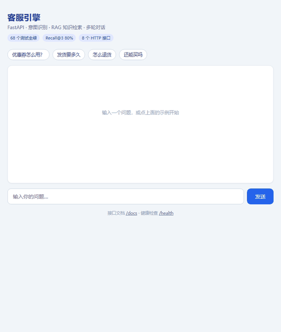
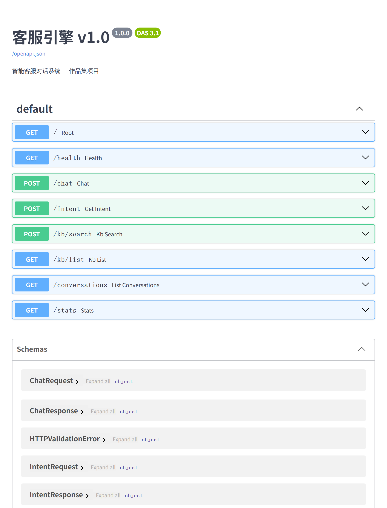

# AI Customer Service Engine

> FastAPI + LLM Intent Recognition + Multi-turn Dialog + RAG Knowledge Base

A customer service agent showcasing AI dialogue engineering capabilities: intent classification, multi-turn state management, retrieval-augmented generation, and full engineering standards (pytest + Docker + CI).

**Quick facts**: 68/68 tests passing · Recall@3 80% · MRR 0.689 · intent accuracy 100% · 8 API endpoints + 1 demo page · ~1,200 LOC

> Metrics are measured on a 15-query labeled set (`tests/eval_set.json`) whose expected answers were derived from the same keyword rules the engine uses — an **in-sample** figure. A held-out set with colloquial queries not in the keyword table would show a lower number (see RETRIEVAL_TUNING.md §5).

```bash
pip install -r requirements.txt && pytest tests/ -q   # test
python -m uvicorn src.main:app --port 8899            # run → http://127.0.0.1:8899
```

Docs: [DELIVERY.md](DELIVERY.md) · [DESIGN.md](DESIGN.md) · [RETRIEVAL_TUNING.md](RETRIEVAL_TUNING.md) (retrieval tuning log with real numbers)

---

## Demo



The built-in page at `/` — type a question or click a sample, get **intent + confidence + KB-grounded reply** in a multi-turn session.

Auto-generated API docs at `/docs` (FastAPI/OpenAPI):



---

## 这个项目从哪来的

我在闲鱼上接设计单——改简历、美化简历、做 PPT、画刀模图。

干了一段时间发现：**真正花时间的不是做，是沟通。**

每个客户都问差不多的话：

- 这个多少钱？
- 几天能好？
- 能改几次？
- 不满意怎么办？

一天重复回十几次，有时候半夜还在打字。于是我想：这些重复的问句，能不能先让程序挡一层？

**第一版很简单**——关键词匹配 + 固定话术。跑起来就发现不够：客户不会按你的关键词说话。有人发"我简历这块能不能再改改"（这是售后修改），有人发"做个折页多少钱"（这是售前报价），关键词全匹配不上。

于是改成 **LLM 意图识别 + 关键词兜底**，再加上知识库检索，让它能回答具体规则（改稿次数、交付格式、退款条件）。

**后来找工作，场景变了。** 面试官不看"我这小店能用就行"，他们看的是"你能不能解决一类问题"。所以我把知识库换成了通用电商 FAQ——问的还是那些问题（发货、退货、优惠券），但换成了一个任何人都能验证的场景。

再往后就是补工程：**68 个测试、Docker、CI、标注评估集、交付文档**。不是为了堆东西，是因为被问过"你这东西怎么证明它是对的"，答不上来很难看。

所以这个项目有两个真实用途：**一边是我接单时真想用的客服工具，一边是给面试官看的工程作品。**

它不是为了做项目而做的项目。

> 下一个想做的：把客户散在聊天记录里的需求，自动整理成结构化的需求单（做什么、什么规格、多久要、能改几次）。**客服是被动回答，需求采集是主动理解**——这两个合起来，才算完整地"懂客户"。

---

## Architecture

```
User Message
    ↓
┌─────────────────────────────────────────────┐
│  FastAPI Server (:8899)                     │
│  GET  /      ← Demo page (chat UI)          │
│  POST /chat   ← Main conversation entry     │
│  POST /intent ← Intent detection            │
│  POST /kb/search ← Knowledge base search   │
│  GET  /health ← Health check               │
└──────────────────┬──────────────────────────┘
                   ↓
┌─────────────────────────────────────────────┐
│  Core Pipeline                              │
│                                             │
│  ① Intent Recognition                        │
│     ├── LLM Classification (primary)         │
│     └── Keyword Fallback (secondary)         │
│                                             │
│  ② Knowledge Retrieval (RAG)                 │
│     ├── Inverted Index + TF-IDF scoring      │
│     └── Hybrid keyword + semantic search     │
│                                             │
│  ③ Dialogue State Management                 │
│     ├── Session history tracking             │
│     ├── Intent-based reply routing           │
│     └── History window limiting              │
│                                             │
│  ④ Reply Generation                          │
│     ├── KB-aware template responses          │
│     └── Confidence-based clarification       │
└─────────────────────────────────────────────┘
                   ↓
┌─────────────────────────────────────────────┐
│  Data Layer                                 │
│  ├── knowledge/*.md  ← Domain knowledge     │
│  ├── conversations/  ← Session history      │
│  └── config.json     ← Runtime config       │
└─────────────────────────────────────────────┘
```

---

## Key Design Decisions

| Component | Approach | Rationale |
|:----------|:---------|:----------|
| **Intent Recognition** | LLM primary + Keyword fallback | Handles complex phrasings; keyword guarantees zero-cost fallback |
| **RAG Retrieval** | Self-built inverted index + TF-IDF + query rewrite | Handles colloquial phrasing via synonym expansion; no embedding model dependency |
| **Confidence Calibration** | Three-tier thresholds (high≥0.85, medium≥0.60, low<0.60) + intent overrides | Complaints require higher confidence; greetings lower; auto-clarification on low confidence |
| **Dialogue State** | Session-based with history window | Predictable memory usage; prevents context overflow |
| **Reply Generation** | Intent-router + KB-context templates | Deterministic responses for common intents; graceful degradation |

---

## Quick Start

```bash
# 1. Clone and setup
git clone <your-repo>
cd cc-engine
pip install -r requirements.txt

# 2. Configure (optional)
cp .env.example .env
# 默认 config.json 指向 http://127.0.0.1:15721（本地 cc-connect 代理）；
# 外部环境请改成你的 LLM 地址，如 https://api.deepseek.com/v1 + deepseek-chat（详见 DELIVERY.md 三种选项）
# 不配 LLM 也能跑：意图走关键词兜底，只是回复质量下降

# 3. Run tests
pytest tests/ -v

# 4. Start server
#    Windows: 双击 start_demo.bat  (最省事)
#    或手动:  python -m uvicorn src.main:app --host 127.0.0.1 --port 8899
#    ⚠️ 不要用 `python -m src.main` (Windows/PowerShell 下 uvicorn 会静默崩溃)
# → http://127.0.0.1:8899  (演示页) / /docs (API 文档)
```

---

## API Reference

### Chat

```http
POST /chat
Content-Type: application/json

{
  "message": "How long does shipping take?",
  "session_id": "user_123",
  "stream": false
}

Response:
{
  "reply": "Shipping typically takes 3-5 business days...",
  "intent": "shipping",
  "confidence": 0.92,
  "session_id": "user_123",
  "turn_count": 1
}
```

### Intent Detection

```http
POST /intent
Content-Type: application/json

{
  "message": "I want to return this item"
}

Response:
{
  "intent": "returns",
  "confidence": 0.88,
  "labels": {"return_reason": "not specified"}
}
```

### Knowledge Base Search

```http
POST /kb/search
Content-Type: application/json

{
  "query": "shipping time",
  "top_k": 3
}
```

---

## Project Structure

```
cc-engine/
├── src/
│   ├── main.py            # FastAPI application (含 / 路由内嵌演示页)
│   ├── intent.py          # Intent classification (LLM + keywords)
│   ├── dialog.py          # Multi-turn dialogue state machine
│   ├── rag.py             # Knowledge base retrieval engine
│   └── models.py          # Pydantic data models
├── knowledge/
│   ├── faq.md             # Frequently asked questions
│   ├── shipping.md        # Shipping policies
│   └── returns.md         # Return/exchange policies
├── conversations/         # Session history (auto-generated)
├── tests/
│   ├── eval_set.json      # 15-query labeled retrieval eval set
│   ├── test_intent.py
│   ├── test_dialog.py
│   ├── test_rag.py
│   ├── test_confidence.py
│   ├── test_query_rewriter.py
│   ├── test_request_log.py
│   ├── test_config.py
│   └── test_http.py       # TestClient 集成测试（/ + /health）
├── src/ragas_eval.py      # Recall@K / MRR evaluation
├── config.json            # Runtime configuration
├── .env.example           # Environment template
├── requirements.txt
├── Dockerfile
└── docker-compose.yml
```

---

## Testing

```bash
# Run all tests
pytest tests/ -v

# Run with coverage
pytest tests/ --cov=src --cov-report=term-missing
```

**Test Coverage**: 68/68 tests passing

| Module | Tests | Status |
|:-------|:-----:|:------:|
| `intent.py` | 6 | ✅ |
| `dialog.py` | 7 | ✅ |
| `rag.py` | 6 | ✅ |
| `query_rewriter.py` | 14 | ✅ |
| `confidence.py` | 19 | ✅ |
| `request_log.py` | 11 | ✅ |
| `config.json` validity | 3 | ✅ |
| `test_http.py` (HTTP 集成) | 2 | ✅ |
| **Total** | **68** | **✅** |

---

## Production Deployment

### Docker

```bash
docker build -t customer-service-engine .
docker run -p 8899:8899 --env-file .env customer-service-engine
```

### Docker Compose

```bash
docker-compose up -d
```

### Kubernetes (future)

```yaml
# See docker-compose.yml for base config
# Add Ingress + HPA for production scaling
```

---

## Extensibility

The architecture supports easy extension:

- **Add new intents**: Extend `KEYWORD_RULES` in `intent.py` and add reply handlers in `dialog.py`
- **Add knowledge base**: Drop new `.md` files in `knowledge/` directory
- **Switch LLM provider**: Modify `classify_by_llm()` in `intent.py` to support different APIs
- **Add vector search**: Replace TF-IDF in `rag.py` with embedding-based retrieval

---

## Lessons Learned

1. **RAG complexity is underestimated** — Self-built inverted index works for small FAQs but breaks down at scale. LlamaIndex/LangChain are worth evaluating for production.

2. **Template replies are a double-edged sword** — Deterministic and fast, but feel robotic. Next iteration should connect LLM for response generation.

3. **Intent confidence calibration matters** — Current thresholds (0.5) are arbitrary. Need systematic evaluation with held-out test data.

4. **Engineering hygiene is non-negotiable** — Tests, Docker, and CI aren't optional for portfolio pieces. They signal professional maturity.

---

## Stats

| Metric | Value |
|:-------|:-----:|
| Lines of Code | ~1,200 |
| Tests | 68/68 passing |
| API Endpoints | 8 (+1 demo page) |
| Knowledge Chunks | 29 |
| Retrieval Recall@3 | 80.0% (15-query labeled set) |
| Retrieval MRR | 0.689 |
| Intent Accuracy | 100% |
| Dependencies | 7 (lightweight) |
| Build Time (Docker) | ~30s |

---

*Built with FastAPI, Python 3.10+, and a lot of coffee.*
